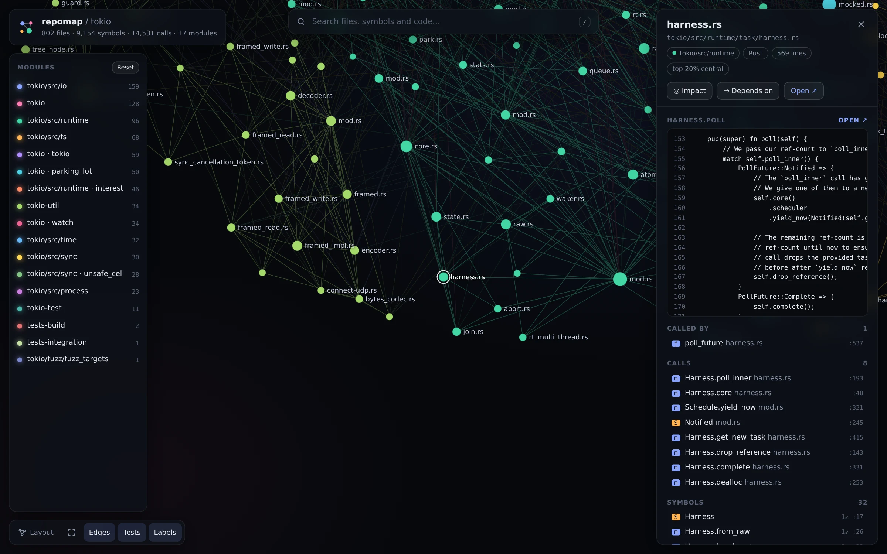
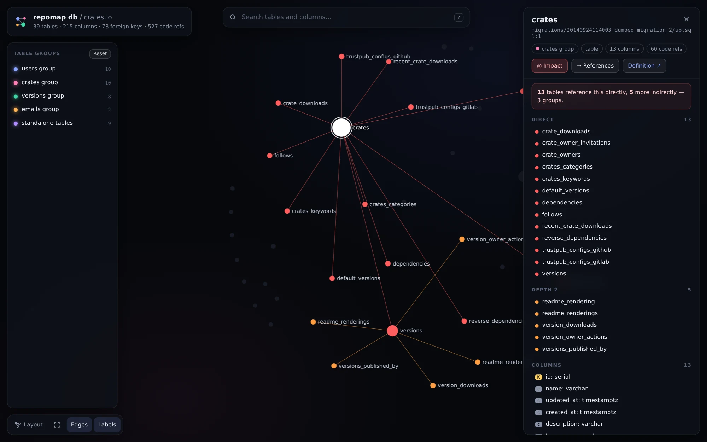

<div align="center">

# repomap

<!-- oneliner --><strong>A map of your codebase for AI agents: code graph, search, call paths and change impact. No API key.</strong><!-- /oneliner -->

Code graph · hybrid search · call paths · change impact · an interactive graph UI.<br>
One Rust binary. Local. No API key. MIT.

```bash
npx -y @sylphx/repomap setup
```

[](https://www.npmjs.com/package/@sylphx/repomap)
[](https://www.npmjs.com/package/@sylphx/repomap)
[](https://github.com/SylphxAI/repomap/actions/workflows/ci.yml)
[](https://registry.modelcontextprotocol.io/)
[](https://glama.ai/mcp/servers/SylphxAI/repomap)
[](https://github.com/SylphxAI/repomap/blob/main/LICENSE) <!-- repomap:agent-ready -->[](https://github.com/SylphxAI/repomap#agent-readiness-score)<!-- /repomap:agent-ready -->

[**Live demo**](https://sylphxai.github.io/repomap/demo) · [Docs](https://sylphxai.github.io/repomap/) · [Quickstart](https://github.com/SylphxAI/repomap#quickstart) · [Tools](https://github.com/SylphxAI/repomap#what-your-agent-gets) · [Graph UI](https://github.com/SylphxAI/repomap#the-graph-ui) · [Benchmarks](https://sylphxai.github.io/repomap/benchmarks) · [Compare](https://github.com/SylphxAI/repomap#how-it-compares)


<sub>The real UI on excalidraw (687 files, indexed in under half a second): search, a symbol's code and callers, then the blast radius of a change. <a href="https://sylphxai.github.io/repomap/demo">Try it in your browser</a>, no install needed.</sub>

</div>

## See it work

Run it on any repository. This is the real output on repomap's own source (v1.5.0, trimmed): ask what breaks if `pagerank` changes.

```text
$ npx -y @sylphx/repomap impact pagerank

# Impact (MEDIUM risk)
Changing: function pagerank (crates/repomap-core/src/graph.rs:639)
2 direct callers, 4 symbols affected in total across 6 files and 3 modules; 5 files importing the changed files; 1 test file to run.

## Direct callers (will break if the contract changes)
- method DbSchema.graph_json — crates/repomap-core/src/db.rs:1981
- function link — crates/repomap-core/src/graph.rs:122

## Indirect (depth 2)
- function assemble — crates/repomap-core/src/index.rs:700
```

One local call, no API key, and an answer your agent can cite as `file:line`.

## Quickstart

```bash
npx -y @sylphx/repomap setup     # add repomap to Claude Code, Codex, Cursor, VS Code, Claude Desktop, Windsurf, Gemini CLI
npx -y @sylphx/repomap serve     # open the graph UI for the current repo
```

Prefer to wire one client by hand? `claude mcp add repomap -- npx -y @sylphx/repomap mcp` for Claude Code; the [Cursor, VS Code, Codex and Docker snippets](#cursor-and-vs-code-one-click) follow.

That's it. Add `--claude-hooks` to also [enrich Claude Code's Grep and Glob](#claude-code-hook). `setup` detects the clients you have, writes their MCP config, and prints every change it made. Run it again and nothing changes. Then ask your agent: *"Use repomap to map this repo."*

### Install from PyPI

Install the `repomap` CLI with pip, or run it without a persistent install using uvx:

```bash
pip install sylphx-repomap
uvx --from sylphx-repomap repomap --version
```

<!-- editor-install:start (generated by scripts/editor-install.ts) -->
### Cursor and VS Code, one click

[](https://cursor.com/en/install-mcp?name=repomap&config=eyJjb21tYW5kIjoibnB4IiwiYXJncyI6WyIteSIsIkBzeWxwaHgvcmVwb21hcCIsIm1jcCJdfQ%3D%3D) · [Install in VS Code](https://insiders.vscode.dev/redirect?url=vscode%3Amcp%2Finstall%3F%257B%2522name%2522%253A%2522repomap%2522%252C%2522command%2522%253A%2522npx%2522%252C%2522args%2522%253A%255B%2522-y%2522%252C%2522%2540sylphx%252Frepomap%2522%252C%2522mcp%2522%255D%257D)

Requires Node 18+. Confirm the install in your editor, open your project, and enable the server. Both links run `npx -y @sylphx/repomap mcp` locally; no API key is needed.

For VS Code from a terminal:

```bash
code --add-mcp '{"name":"repomap","command":"npx","args":["-y","@sylphx/repomap","mcp"]}'
```

Or add the server to `.cursor/mcp.json`:

```json
{
  "mcpServers": {
    "repomap": {
      "command": "npx",
      "args": [
        "-y",
        "@sylphx/repomap",
        "mcp"
      ]
    }
  }
}
```

For `.vscode/mcp.json`, use the VS Code `servers` format:

```json
{
  "servers": {
    "repomap": {
      "type": "stdio",
      "command": "npx",
      "args": [
        "-y",
        "@sylphx/repomap",
        "mcp"
      ]
    }
  }
}
```
<!-- editor-install:end -->

<details>
<summary>Manual MCP config</summary>

```json
{
  "mcpServers": {
    "repomap": { "command": "npx", "args": ["-y", "@sylphx/repomap", "mcp"] }
  }
}
```

Claude Code: `claude mcp add repomap -- npx -y @sylphx/repomap mcp`
Claude Desktop, one click: download `repomap-<version>.mcpb` from the [latest release](https://github.com/SylphxAI/repomap/releases/latest), open it, and pick your project folder.
Claude Code plugin: `/plugin marketplace add SylphxAI/repomap`, then `/plugin install repomap@repomap`
Codex (`~/.codex/config.toml`):

```toml
[mcp_servers.repomap]
command = "npx"
args = ["-y", "@sylphx/repomap", "mcp"]
```

Docker (stdio, amd64/arm64):

```json
{ "mcpServers": { "repomap": { "command": "docker", "args": ["run", "-i", "--rm", "-v", "/path/to/repo:/workspace:ro", "ghcr.io/sylphxai/repomap"] } } }
```

The server indexes the client's workspace root (or its working directory, or `REPOMAP_ROOT`). Every tool also takes `root`.

The GHCR image includes the embedding model. The root `Dockerfile` is a lightweight build for MCP catalogs and defaults to keyword search without the model.
</details>

## Proof: file localization on SWE-bench Verified

<!-- localization-hero:start -->
<p>One issue-text search finds every fix file in the top 10 for <strong>83.0% of SWE-bench Verified issues</strong> (semble: 71.0%). File retrieval, not issue resolution.</p>

<details><summary>Chart values and evaluation protocol</summary>
<table><caption>SWE-bench Verified: every gold fix file in the top k files</caption><thead><tr><th scope="col">Method</th><th scope="col">Acc@1</th><th scope="col">Acc@5</th><th scope="col">Acc@10</th></tr></thead><tbody><tr><th scope="row">repomap</th><td>48.8%</td><td>74.8%</td><td>83.0%</td></tr>
<tr><th scope="row">semble</th><td>34.0%</td><td>61.6%</td><td>71.0%</td></tr>
<tr><th scope="row">BM25</th><td>20.8%</td><td>45.4%</td><td>55.8%</td></tr></tbody></table>
<p>Defaults selected on 300 disjoint SWE-bench test instances, excluding every Verified ID, then frozen before one evaluation on all 500 Verified instances. One search per issue, at its base commit; gold files are used only for scoring. All three methods scored 500/500, with zero errors.</p>
<p><a href="https://sylphxai.github.io/repomap/benchmarks#file-localization">Split definitions, pinned revisions and full results</a> · <a href="https://github.com/SylphxAI/repomap/blob/main/bench/localization/results.json">Committed chart data</a></p>
</details>
<p>Trade-off: on semble's public code-search set, NDCG@10 is <strong>0.845</strong> versus semble's <strong>0.851</strong>; semble wins there. This is not a claim of better search on every task. <a href="https://sylphxai.github.io/repomap/benchmarks#search-quality">Measured search quality and limitations</a>.</p>
<!-- localization-hero:end -->

## Why

Agents burn most of their context on `grep`, `ls` and reading whole files just to work out where things are. repomap gives them the map up front:

- **Where is it?** Hybrid search that matches symbol names, the words inside functions *and* what the code means, with the lines that matched. Ask "where are failed requests retried" or `parseConfig`.
- **What is this?** One call returns a symbol's code, callers with call-site lines, callees, subtypes and the tests that reach it.
- **How does A reach B?** The shortest call path, each hop cited `file:line`.
- **What breaks if I change this?** Direct and indirect callers, importing files, modules touched, tests to run, and a risk level. Point it at your `git diff` before you commit.
- **What does this repo look like?** Modules found from real dependencies (not just folders), the most central files, the most used symbols, and entry points.

All of it comes from a local index: tree-sitter parsing, a resolved import and call graph, PageRank, Louvain communities, BM25 over AST chunks, and a small static code embedding model (33 MB, downloaded once from Hugging Face, then offline). Nothing leaves your machine, and no API is called; the model download is the only network request (set `REPOMAP_EMBED=0` to skip it).

## What your agent gets

<!-- tools:start (generated by `repomap tools`; CI checks it) -->
Six tools, each with an obvious job:

| Tool | Ask it | Returns |
|---|---|---|
| `map` | "Give me the lay of the land" / `focus: "src/server"` | Modules, central files, key symbols, entry points; an outline with line numbers when focused |
| `search` | `"where are failed requests retried"`, `"parseConfig"` | Ranked `file:line` ranges (functions, methods, classes) by keywords, names and meaning, with the matching lines |
| `context` | `SessionStore.refresh`, `src/auth/token.ts`, `token.ts:42` | Code, callers (with call sites), callees, subtypes, members, imports, importers, tests |
| `trace` | `from: handleRequest, to: db.query` | Shortest call path, or the call tree above/below a symbol |
| `impact` | `target: verifyToken` or `changed: true` | Risk level, callers by depth, importing files, modules, tests to run |
| `db` | `table: users`, or `url_env: DATABASE_URL` for a live database | Tables, keys, indexes, and the code (`file:line`) that queries each table |
<!-- tools:end -->

Answers are compact text that cites `file:line`, so they cost few tokens. Pass `format: "json"` for structured output.

```text
> impact target=decode

# Impact (LOW risk)
Changing: function decode (src/auth/token.ts:14)
1 direct caller, 3 symbols affected in total across 3 files and 2 modules; 1 file importing the changed files; no tests reach this.

## Direct callers (will break if the contract changes)
- function verifyToken — src/auth/token.ts:8

## Indirect (depth 2)
- method SessionStore.refresh — src/auth/session.ts:5

## Indirect (depth 3)
- function handleRefresh — src/api/router.ts:6

## Importing files
- src/auth/session.ts
```

The same commands work in your terminal: `repomap map`, `repomap search "…"`, `repomap context X`, `repomap trace A B`, `repomap impact --changed`, `repomap db`.

## The graph UI

```bash
npx -y @sylphx/repomap serve            # live, with code preview
npx -y @sylphx/repomap export           # repomap.html: one self-contained file you can publish
```

<table>
<tr>
<td width="50%"></td>
<td width="50%"></td>
</tr>
<tr>
<td><b>Impact.</b> Select a file and press <kbd>i</kbd>: everything that depends on it lights up by depth, with a list you can click through.</td>
<td><b>Code.</b> Click a symbol to see its source, callers and callees. <b>Open ↗</b> jumps to your editor or to GitHub.</td>
</tr>
</table>

- WebGL rendering (Sigma.js) that stays smooth with tens of thousands of files and edges
- Modules coloured and clustered by their real dependencies, file size by PageRank; tests, examples and docs are muted and one click away
- <kbd>/</kbd> searches files, symbols and code; <kbd>d</kbd> shows dependencies; <kbd>f</kbd> fits the view
- Click a module to focus it, <kbd>Shift</kbd>-click to hide it; toggle tests, edges and labels
- `export` writes one HTML file with deep links (`#path/to/file`) and GitHub links pinned to your commit. It's a good fit for a README, a wiki or a design review.

## Database map

```bash
npx -y @sylphx/repomap db                              # from migrations / Prisma / Drizzle / SQLAlchemy / Diesel / Django
npx -y @sylphx/repomap db --url-env DATABASE_URL       # live Postgres, MySQL or SQLite, read-only
npx -y @sylphx/repomap db users                        # one table: columns, indexes, who references it, where it is queried
npx -y @sylphx/repomap db --serve                      # the same graph UI, for tables and foreign keys
```

repomap reads your schema from the repository: SQL migrations (applied in order, with `down` migrations skipped), `schema.prisma`, Drizzle `pgTable`/`mysqlTable`/`sqliteTable`, SQLAlchemy and Flask-SQLAlchemy models, Diesel `table!`, and Django `models.py` (fields, `ForeignKey`/`ManyToManyField`, `Meta`, implicit join tables). It can also introspect a live database. Each table is linked to the code that queries it: raw SQL (`FROM users`), Prisma (`prisma.user.findMany`), Diesel (`users::table`), Django (`Post.objects…`), and ORM models or tables used by files that import them.



Live connections are strictly read-only:
- **Postgres** runs in a `READ ONLY` transaction that the server must confirm.
- **MySQL** runs in a `START TRANSACTION READ ONLY` transaction.
- **SQLite** is opened read-only with `query_only`.

Only catalog metadata is read, never table rows. The connection string comes from an argument or an environment variable, and it is never stored or printed. Agents get the same data through the `db` MCP tool; pass `url_env` rather than the URL itself.

## Agent-readiness score

```bash
npx -y @sylphx/repomap score
```

The score rates how well an AI agent can work in the repository, from 0 to 100. It covers eight checks:
- agent instructions (AGENTS.md / CLAUDE.md and how useful they are)
- discoverable build and test commands
- test coverage
- CI
- module boundaries
- file sizes
- docs
- types

Each check that falls short comes with a concrete fix, and the score ends with a badge line for your README. For CI, use `--min 70`; `--update-readme README.md` refreshes the badge.

Keep the badge fresh with the GitHub Action:

```yaml
# .github/workflows/agent-ready.yml
on: { push: { branches: [main] } }
permissions: { contents: write, pull-requests: write }
jobs:
  score:
    runs-on: ubuntu-latest
    steps:
      - uses: actions/checkout@v4
      - uses: SylphxAI/repomap@v1
        with:
          update-readme: true   # opens or updates one PR with the fresh badge
          min-score: 0          # set e.g. 70 to fail below a bar
```

## Claude Code hook

```bash
npx -y @sylphx/repomap setup --claude-hooks
```

This is opt-in and safe to run again; `setup --remove` takes it out. It installs a PreToolUse hook: whenever Claude Code runs `Grep` or `Glob`, repomap adds where the symbol is defined, who calls it and which module it belongs to. It answers in tens of milliseconds and never blocks the search.

```text
repomap (code map) for this search:
- function `compose` defined at src/compose.ts:15 (module router); 3 callers: Hono.route (src/hono-base.ts:228), Hono.#dispatch (src/hono-base.ts:452), every (src/middleware/combine/index.ts:102)
```

## Languages

Parsed with tree-sitter for symbols, calls, imports and inheritance: **TypeScript, TSX, JavaScript, Python, Go, Rust, Java, Kotlin, Swift, C, C++, C#, Ruby, PHP.**
Search also covers Markdown, YAML, TOML, JSON, SQL, shell, Protobuf, GraphQL, HTML/CSS, Vue, Svelte, Scala and more.

Modules are found among your core code only. Tests, examples, docs and benchmarks are grouped separately, so they never name or blur a module.

Import resolution understands relative paths, `@/` aliases, npm workspace packages, Python packages and relative imports, Go modules, Rust `mod`/`use`/workspace crates, Java/PHP namespaces, C/C++ includes and Ruby `require`. `.gitignore` is respected, and so is `.repomapignore`.

## Search that understands the question

On [semble's public code-search benchmark](https://sylphxai.github.io/repomap/benchmarks) (63 repositories, 19 languages, 1,251 questions), repomap's `search` scores NDCG@10 **0.845**, versus semble **0.851** on the same runner. The previous repomap score was 0.851: stronger issue localization trades about 0.006 here. On our 60 large-repository questions, repomap scores **0.846** versus semble **0.799**, but semble still wins on VS Code. The 137M-parameter CodeRankEmbed model's published score is 0.839 and plain BM25's 0.673 (cited, not re-run).

On [file localization](https://sylphxai.github.io/repomap/benchmarks#file-localization) (500 SWE-bench Verified issues, one `search` call with the issue text), repomap finds every fix file in the top 10 for **83.0%** of issues (Acc@10; **74.8%** at 5, **48.8%** at 1), versus semble's **71.0% / 61.6% / 34.0%**. Before this change, repomap scored 62.2% / 51.8% / 23.6%. Plain BM25 scores 55.8% at 10, and repomap with embeddings off 77.6%. Same-run median index/query costs are **1.682 s / 54.4 ms**, versus the old binary's 1.686 s / 59.8 ms and semble's 12.813 s / 354.4 ms. Defaults were selected only on a disjoint 300-instance tuning split, then frozen before one Verified measurement. Agent systems such as LocAgent report higher numbers on a different subset with a language model in the loop; those are cited, not re-run.

This needs no GPU, no vector database and no API key. A 33 MB static code model runs on the CPU, next to BM25 and symbol names.

## Fast

The index is built in parallel and cached per file, so after the first run only changed files are parsed again. The MCP server keeps the graph in memory and refreshes it when files change.

Measured on a 4 vCPU GitHub-hosted runner ([method and full table](https://sylphxai.github.io/repomap/benchmarks)):

| Repository | Code files | Cold index | Warm index | search p50 | impact p50 |
|---|---:|---:|---:|---:|---:|
| kubernetes | 11,710 | 13.1 s | 2.0 s | 74 ms | 6 ms |
| vscode | 6,126 | 9.3 s | 1.4 s | 17 ms | 8 ms |
| django | 2,271 | 2.6 s | 0.5 s | 24 ms | 1 ms |
| rust-analyzer | 1,512 | 2.1 s | 0.4 s | 8 ms | 2 ms |

## How it compares

| | **repomap** | GitNexus | Serena | claude-context | Aider repo map |
|---|---|---|---|---|---|
| Licence | **MIT** | PolyForm Noncommercial | MIT | MIT | Apache-2.0 (inside Aider) |
| Setup | `npx … setup`, one binary, or a one-click `.mcpb` | `npx`, Node | Python + language servers | Vector DB + embedding API key | Part of Aider |
| API key / network | **None** (model downloaded once) | None for the graph | None | Required (embeddings) | None |
| Code graph (calls, imports, inheritance) | ✅ | ✅ | Via LSP references | — | Ranking only |
| Change impact / blast radius | ✅ incl. `git diff` | ✅ | — | — | — |
| Call path between two symbols | ✅ | ✅ | — | — | — |
| Search | ✅ names + BM25 + local embeddings | ✅ | ✅ symbols | Semantic (vectors) | — |
| Interactive graph UI | ✅ local + static export | ✅ | — | — | — |
| Claude Code Grep/Glob hook | ✅ opt-in | ✅ | — | — | — |
| Database schema map linked to code | ✅ live (read-only) + migrations/ORMs | — | — | — | — |
| Agent-readiness score + badge | ✅ + GitHub Action | — | — | — | — |
| Module detection | ✅ Louvain | ✅ | — | — | — |
| Edits code | — (read-only) | — | ✅ | — | ✅ |
| Engine | Rust | TypeScript | Python | TypeScript | Python |

Pick Serena if you want LSP-precise refactoring edits. repomap is for understanding and navigating a codebase with zero setup, including semantic search without a vector database or an API key, and a licence you can use at work. Search quality is measured on public benchmarks in [Benchmarks](https://sylphxai.github.io/repomap/benchmarks).

## Free

Everything repomap does is free under MIT, including the multi-repository workspace (`--workspace`) and `impact` in your own CI. There is no licence key and no paid tier.

## CLI

```text
repomap setup [--client cursor,codex] [--claude-hooks] [--dry-run] [--remove]
repomap serve [dir] [--port 7878] [--no-open]
repomap export [dir] [--out repomap.html] [--json]
repomap map [dir-to-focus] [-C root] [--tokens 1000] [--json]
repomap search <query> [--path src/] [--kind function] [--limit 10]
repomap context <target> [--code-lines 60]
repomap trace <from> [to] [--callers] [--depth 3]
repomap impact [targets…] [--changed] [--base main]
repomap db [table] [--url-env VAR | --url URL] [--serve | --out db.html] [--json]
repomap score [dir] [--json] [--min N] [--update-readme README.md [--insert]]
repomap index [dir] [--no-cache] [--json]
repomap mcp [--root dir]
```

Binaries for macOS (arm64, x64), Linux glibc (x64, arm64) and Windows x64 ship as npm optional dependencies. They're also attached to each [GitHub release](https://github.com/SylphxAI/repomap/releases). From source: `cargo install --git https://github.com/SylphxAI/repomap sylphx-repomap`.

## Migrating from Spine, Locus or CodeRAG

`@sylphx/spine`, `@sylphx/locus` and `@sylphx/coderag` are thin aliases of `@sylphx/repomap`, and their old tool names still work. See the [migration guide](https://sylphxai.github.io/repomap/guide/migrate) for the name mapping and how to switch.

## Contributing

```bash
cargo test --workspace          # engine + CLI tests
bun install && bun run build:ui # rebuild the UI bundle (ui/ -> crates/repomap/assets/)
cargo run -p sylphx-repomap -- serve .
```

Issues and PRs are welcome, and new language support is especially useful: add a grammar and a query in `crates/repomap-core/src/lang.rs`.

## Also from Sylphx

Built by [Sylphx](https://sylphx.com).

<!-- generated:also-from -->
- [**anymd**](https://github.com/SylphxAI/anymd): Any file (PDF, Word, PowerPoint, Excel, EPUB, HTML, images) to clean Markdown for AI agents.
- [**lockdocs**](https://github.com/SylphxAI/lockdocs): Exact-version library docs from your lockfile. Local, offline, no rate limits.
- [**skills**](https://github.com/SylphxAI/skills): Battle-tested agent skills for Claude Code and Codex, installed in one command.
- [**readme-mark**](https://github.com/SylphxAI/readme-mark): Beautiful README images from one URL: banners, badges, icons and stats cards.

More from Sylphx: https://sylphx.com/open-source
<!-- /generated:also-from -->

## Star history

[](https://star-history.com/#SylphxAI/repomap&Date)

## Privacy

repomap runs on your machine. Indexing, search and every query read your code
locally and send nothing anywhere. The one network request repomap makes is a
single download of the embedding model from Hugging Face the first time you
search; it sends no code. Set `REPOMAP_EMBED=0` to skip it and use keyword
search only. `repomap export` files hold paths, symbol names and line numbers,
never source. See [SECURITY.md](https://github.com/SylphxAI/repomap/blob/main/SECURITY.md) for the full boundary.

## Support

Questions, a bug, or a team rollout? Email [hi@sylphx.com](mailto:hi@sylphx.com) or [open an issue](https://github.com/SylphxAI/repomap/issues).

---

MIT licence. © Sylphx Limited, registered in England and Wales, company no. 16438428. Registered office: 128 City Road, London EC1V 2NX, United Kingdom. Email [hi@sylphx.com](mailto:hi@sylphx.com). [Privacy](https://sylphx.com/legal/privacy) · [Terms](https://sylphx.com/legal/terms) · [sylphx.com](https://sylphx.com)
